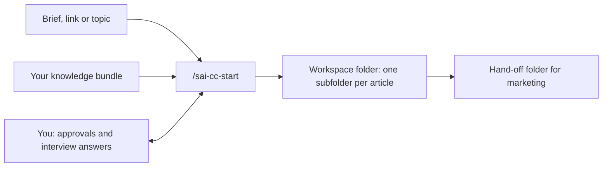

# sai-content-cluster

A set of Claude Code skills that helps a subject-matter expert write blog articles that search engines and AI assistants can find, understand and quote, in the expert's own voice.

You bring the expertise. The system does the research, structure, optimisation and checking, and stops to ask you at the moments that matter.

---

## In one minute

- **What it makes:** finished blog articles, ready for a website team to publish. Each one comes with its title, meta description, structured data and a list of things to check before publishing.
- **What it starts from:** a content brief from your marketing team, or just the link to an existing article, or just a topic.
- **What makes the articles yours:** a short interview with you, plus a "knowledge bundle" that describes your views and writing style.
- **What it organises:** a *topic cluster*, one main article (the pillar) with several shorter related articles (spokes) that link to each other.
- **How you use it:** type `/sai-cc-start` in Claude Code and follow the prompts.

---

## Words you'll see

| Word | What it means |
|---|---|
| **Pillar** | The main, broad article on a topic. Example: "Product Lifecycle Management". |
| **Spoke** | A narrower article that goes deeper on one part of the pillar's topic. Example: "Product Sunset Strategy". |
| **Topic cluster** | A pillar plus its spokes, all linking to each other. |
| **Brief** | The plan for one article: who it's for, which search phrases it should rank for, what it must cover. |
| **SEO** | Search engine optimisation: making an article easy for Google to find and rank. |
| **AEO / GEO** | Answer and generative engine optimisation: making an article easy for AI assistants (ChatGPT, Gemini, Google's AI answers) to quote. |
| **Knowledge bundle** | A folder of Markdown files about the author (experience, opinions, writing style). The system reads it; it never changes it without your approval. |
| **Checkpoint** | A point where the system stops and waits for your "approve" or your changes. |

---

## How the system works



There are four pieces:

1. **The skills** (this repo). Each skill does one job, such as writing the outline or checking the draft. `/sai-cc-start` runs them in the right order, so it's the only command you normally need.
2. **Your workspace.** A folder on your computer where every article gets its own subfolder. Each step saves a numbered file there, so you can always see where things stand and pick up later.
3. **A settings file** (`content-cluster.config.md`) that tells the skills about *your* company, website and author bundle. Nothing about any company or person is built into the skills.
4. **You.** You approve the plan, answer interview questions and approve the final article.

---

## The workflow, step by step

| Step | What the system does | What you do |
|---|---|---|
| 1. Brief | Reads your marketing brief, or builds one by researching the topic and the current search results | ① **Approve** the brief (only when the system built it) |
| 2. Place in the cluster | Decides whether the article is a pillar or a spoke, and which search phrases it "owns" so articles don't compete with each other | Nothing |
| 3. Audit | If the article already exists online, reads it and lists what to keep, rewrite, cut or add | Nothing |
| 4. Outline | Plans the headings, tables and diagrams, and marks the places that need your real experience | ② **Approve** the outline |
| 5. Interview | Asks you a few specific questions (a real example, a decision you made, a mistake you see) | ③ **Answer** the questions |
| 6. Draft | Writes the article in your voice, using your answers | Nothing |
| 7. Optimise | Adds the title, meta description, short answers AI assistants can quote, FAQs, links and structured data | Nothing |
| 8. Humanise | Removes phrases that sound machine-written, without touching the optimised parts | Nothing |
| 9. Check | Runs 15 checks (brief followed, facts sourced, no copying between articles, no sales pitch, and more) and fixes what it can | Nothing |
| 10. Final | Shows you the finished article and anything that still needs checking | ④ **Approve**, and confirm any lines written in the first person |

You can stop at any checkpoint and continue another day with `/sai-cc-start continue <article-name>`.

### After the pillar is approved

The system lists the spokes the cluster needs and drafts their briefs **one at a time**. After each one it pauses. Say **"next"** for the next brief, give changes, or say **"draft the rest"** to do them all without stopping. Each spoke is then written through the same 10 steps.

### When the whole cluster is done

Run `/sai-cc-handoff <pillar>`. It makes one folder for the marketing team containing:

- `00 READ ME`: what's ready, the decisions marketing needs to make, and checklists for before and after publishing
- `01 PILLAR - …`: the pillar article, named so it's easy to spot
- `02 SPOKE - …` and onwards: the spokes, with `[new page]` or `[not recommended]` in the name where that applies
- `NN Cluster map`: how the articles connect and link to each other

Only finished articles go in, never the working files. You then upload or share the folder however your team prefers (Google Drive, SharePoint, email). The skill doesn't upload anything itself.

---

## Four ways to start

```
/sai-cc-start path/to/brief.md          I have a brief from marketing
/sai-cc-start https://yoursite.com/x/   I have an existing article but no brief
/sai-cc-start "topic or keyword"        I have only a topic (new article)
/sai-cc-start plan a cluster for X      I want to plan a whole cluster first
/sai-cc-start continue <article-name>   Carry on where I stopped
```

---

## Install

You need [Claude Code](https://claude.com/claude-code).

```bash
git clone https://github.com/saisat/sai-content-cluster.git
cd sai-content-cluster
./install.sh /path/to/your/workspace
```

Restart Claude Code in that workspace and type `/sai-cc-start`. The first time, it runs `/sai-cc-setup`, which asks a few questions (company context file, website address, spelling, where your knowledge bundle lives) and creates the settings file and folders.

Other install options:

```bash
./install.sh /path/to/workspace --copy        # copy the files instead of linking them
./install.sh --global                         # make the skills available in every workspace
./install.sh /path/to/workspace --uninstall   # remove them
```

Always install the whole set together: every skill reads shared files from `sai-cc-core`.

---

## What it will never do

- **Publish anything.** It writes files on your computer. People publish.
- **Change URLs or set up redirects.** It can flag them for the website team to look into, nothing more.
- **Invent facts, numbers or stories.** Statistics need a source. First-person stories come only from your interview answers, and you confirm them at the end.
- **Add sales pitches** when your settings say articles are educational only.
- **Change your knowledge bundle without asking.** It may *suggest* additions after an interview. Nothing is changed unless you approve, and it never commits or pushes the bundle.

---

## Folder layout

What the setup creates in your workspace:

```
content-cluster.config.md          your settings
topic-clusters/
  _system/                         shared across all clusters
    cluster-registry.md            every article, its role and the phrases it owns
    site-urls.csv                  known pages on your site (for safe internal links)
    changelog.md                   what happened, and when
  <pillar>/
    cluster-map.md                 this cluster's plan
    marketing-handoff.md           the READ ME for marketing
    _handoff/<date>/               the folder you give to marketing
    <article>/                     one folder per article:
      01-brief.md  02-existing.md  03-audit.md  04-outline.md  05-interview.md
      06-draft.md  07-optimised.md  07-final.md (the finished article)  08-qa.md
```

---

## The skills

| Skill | What it does |
|---|---|
| `sai-cc-start` | The front door: works out what you have and runs everything in order |
| `sai-cc-setup` | One-time setup for a workspace |
| `sai-cc-brief-intake` | Turns any marketing brief into the standard brief format |
| `sai-cc-brief-builder` | Builds a brief when you don't have one |
| `sai-cc-cluster-architect` | Plans the cluster: pillar, spokes, who owns which search phrases, links |
| `sai-cc-article-audit` | Reads an existing article and lists what to keep, change or cut |
| `sai-cc-outline` | Plans the article and the interview questions |
| `sai-cc-sme-interview` | Interviews you for real examples and opinions |
| `sai-cc-draft` | Writes the draft in your voice |
| `sai-cc-seo-aeo` | Optimises for search engines and AI assistants |
| `sai-cc-humanize` | Removes machine-sounding phrasing |
| `sai-cc-qa` | Runs the 15 final checks |
| `sai-cc-okf-update` | Applies bundle changes you approved (never commits or pushes) |
| `sai-cc-handoff` | Builds the folder for the marketing team |
| `sai-cc-core` | Shared rules and templates used by all the others (you don't run it) |

Any skill can also be run on its own for one article, for example `/sai-cc-qa topic-clusters/<pillar>/<article>`.

---

## Optional tools

The skills work without these, but they're better with them.

| Tool | What it helps with | Without it |
|---|---|---|
| `humanizer` Claude Code skill | Removing machine-sounding phrasing | A built-in checklist is used |
| `defuddle` (`npm i -g defuddle`) | Reading existing web articles accurately | Claude reads the page another way, or you paste it in |
| `pandoc` (`brew install pandoc`) | Reading briefs supplied as Word files | Save the brief as Markdown or paste it |
| `git` | Keeping your knowledge bundle up to date | Point the settings at a folder |
| `python3` | Checking structured data and building the hand-off folder | Checks are done by eye; hand-off needs Python |
