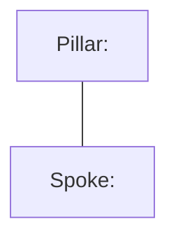

# <Pillar topic> — Cluster Map

## Scope
<What this pillar covers and what it explicitly does not.>

## Map

## Pages

| Role | Page | Owns | Links to | Article status |
|---|---|---|---|---|

## Gaps (spokes that should exist but don't)

| Proposed spoke | Target query | Evidence | Priority |
|---|---|---|---|
